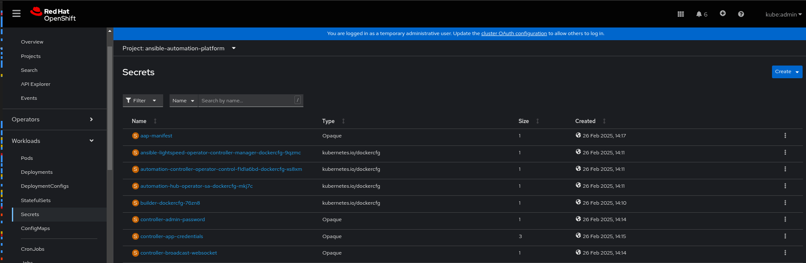
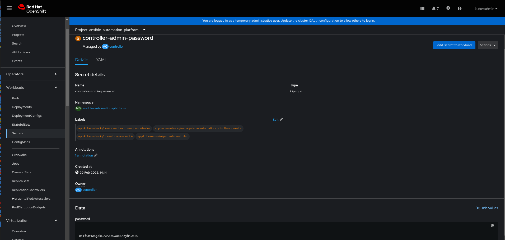
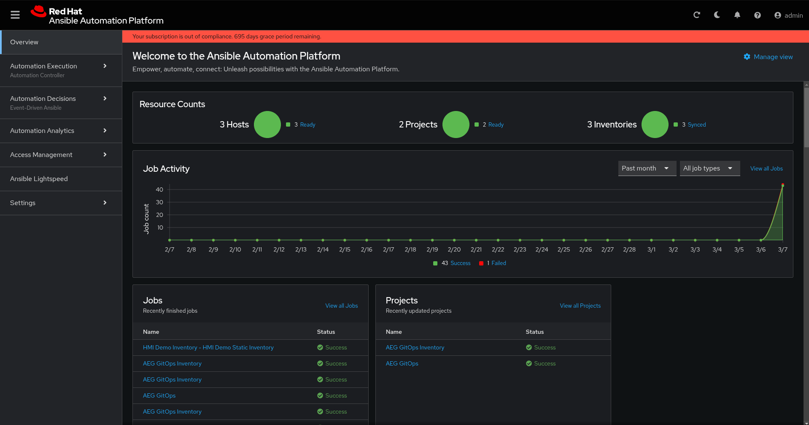

:toc: 
:imagesdir: /images
:_content-type: ASSEMBLY
include::modules/comm-attributes.adoc[]

[id="ansible-automation-pattern"]
== Logging in to the Ansible Automation Platform

The default login user for the AAP interface is `admin`, and the password is randomly generated during installation. This password is required to access the interface.
However, logging into the interface is not necessary, as the pattern automatically configures the AAP instance. The pattern retrieves the password by using the same method as the `ansible_get_credentials.sh` script (described below).

If you need to inspect the AAP instance or change its configuration, there are two ways to log in. Both methods give access to the same instance using the same password.

[id="logging-in-using-a-secret-retrieved-from-the-openshift-console"]
=== Logging in using a secret retrieved from the OpenShift Console

Follow these steps to log in to the Ansible Automation Platform using the OpenShift console:

. In the OpenShift console, go to *Workloads* > *Secrets* and select the `ansible-automation-platform` project if you want to limit the number of secrets you can see.
+
.AAP secret

.. Select the `aap-admin-password`. 

.. In the *Data* field click *Reveal values* to display the password. 
+
.AAP secret detail

. Under *Networking* > *Routes*, click the URL for the `aap` route to open the Ansible Automation Platform interface. 

.. Log in using the `admin` user and the password you retrieved from the `aap-admin-password` secret. A screen similar to the following appears:
+
.AAP login

[id="logging-in-using-secret-retrieved-using-script-ansible_get_credentials"]
=== Logging in using a secret retrieved with ansible_get_credentials.sh

Follow this procedure to log in to the Ansible Automation Platform using the `ansible_get_credentials.sh` script:

. From the top-level pattern directory (ensuring you have set `KUBECONFIG`), run the following command:
+
[source,terminal]
----
$ ./pattern.sh ./scripts/ansible_get_credentials.sh
----
+
This script retrieves the URL for your Ansible Automation Platform instance and the password for its `admin` user. The password is auto-generated by the AAP operator by default. The output of the command looks like this (your password will be different):
+
[source,text]
----
[WARNING]: No inventory was parsed, only implicit localhost is available

PLAY [Retrieve Credentials for AAP on OpenShift] *******************************************************************

TASK [Retrieve API hostname for AAP] *******************************************************************
ok: [localhost]

TASK [Set ansible_host] *****************************************************************
ok: [localhost]

TASK [Retrieve admin password for AAP] *****************************************************************************
ok: [localhost]

TASK [Set admin_password fact] ****************************************************************************************
ok: [localhost]

TASK [Report AAP Endpoint] *****************************************************************************************
ok: [localhost] => {
    "msg": "AAP Endpoint: https://aap-ansible-automation-platform.apps.kevstestcluster.aws.validatedpatterns.io"
}

TASK [Report AAP User] ******************************************************************************
ok: [localhost] => {
    "msg": "AAP Admin User: admin"
}

TASK [Report AAP Admin Password] *******************************************************************
ok: [localhost] => {
    "msg": "AAP Admin Password: XoQ2MoU88ibAwUZI8tHu194DP304UEqz"
}

PLAY RECAP *******************************************************************************
localhost                  : ok=7    changed=0    unreachable=0    failed=0    skipped=0    rescued=0    ignored=0
----

== Pattern AAP Configuration Details

This section describes the AAP configuration during the pattern installation. All of the configuration discussed in this section is applied by the https://charts.validatedpatterns.io/charts/aap-config[aap-config] chart. This chart embeds
https://validatedpatterns.io/patterns/ansible-gitops-framework/[AGOF] v3 to apply an AAP Config-as-Code (CaC) configuration to the AAP instance in the cluster.

The chart automates the configuration of the Ansible Automation Platform (AAP) by executing a series of Ansible playbooks. These playbooks perform tasks such as retrieving credentials, parsing secrets, and configuring the AAP instance. The
chart also runs a Kubernetes CronJob to re-apply the config-as-code repository periodically, so if the repository is
updated the config in AAP will be updated.
