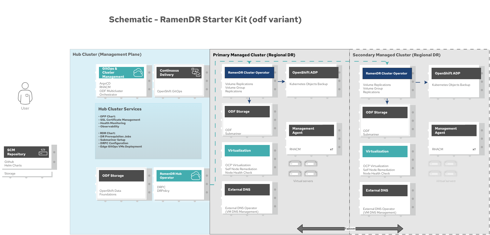
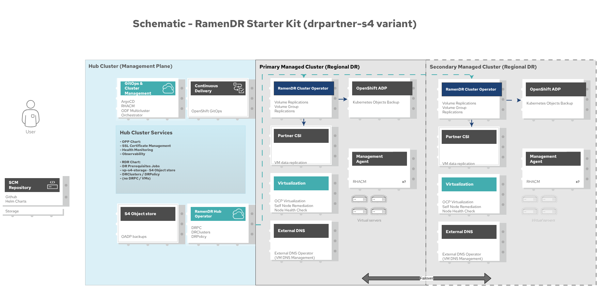

:toc:
:imagesdir: /images
:_content-type: ASSEMBLY
include::modules/comm-attributes.adoc[]

[id="ramendr-architecture"]
= Architecture

This page describes component schematics, connectivity overview diagrams, and TLS/CA handling for each install variant. For hub-to-managed network paths and ports, see link:/patterns/ramendr-starter-kit/connectivity/[Connectivity].

[id="architecture-diagrams"]
== Architecture diagrams

Each install variant has a full hub/spoke schematic exported as PNG from draw.io source. PNG and draw.io files live in `static/images/ramendr-starter-kit/`.

[cols="2,1,2,2",options="header"]
|===
| Diagram | Variant | PNG | draw.io source

| `ramendr-architecture-odf`
| `odf`
| link:/images/ramendr-starter-kit/ramendr-architecture-odf.png[`ramendr-architecture-odf.png`]
| link:/images/ramendr-starter-kit/ramendr-architecture-odf.drawio[`ramendr-architecture-odf.drawio`]

| `ramendr-architecture-techdemo`
| `techdemo`
| link:/images/ramendr-starter-kit/ramendr-architecture-techdemo.png[`ramendr-architecture-techdemo.png`]
| link:/images/ramendr-starter-kit/ramendr-architecture-techdemo.drawio[`ramendr-architecture-techdemo.drawio`]

| `ramendr-architecture-drpartner-s4`
| `drpartner-s4`
| link:/images/ramendr-starter-kit/ramendr-architecture-drpartner-s4.png[`ramendr-architecture-drpartner-s4.png`]
| link:/images/ramendr-starter-kit/ramendr-architecture-drpartner-s4.drawio[`ramendr-architecture-drpartner-s4.drawio`]

| `ramendr-architecture-minimal`
| `minimal`
| link:/images/ramendr-starter-kit/ramendr-architecture-minimal.png[`ramendr-architecture-minimal.png`]
| link:/images/ramendr-starter-kit/ramendr-architecture-minimal.drawio[`ramendr-architecture-minimal.drawio`]

| `hub-managed-connectivity`
| All variants
| link:/images/ramendr-starter-kit/hub-managed-connectivity-odf.png[`hub-managed-connectivity-odf.png`] (and per-variant tabs)
| link:/images/ramendr-starter-kit/hub-managed-connectivity.drawio[`hub-managed-connectivity.drawio`]
|===

[id="architecture-odf"]
=== `odf` schematic

Full hub/spoke schematic. DRPolicies live on the hub with the RamenDR Hub Operator and become volume replications and volume group replications on the managed clusters. The hub operator orchestrates the RamenDR Cluster Operators, which manage those replications plus {ocp-data-short} and OpenShift ADP (Kubernetes object backups), along with Submariner and Edge GitOps VMs.

.ramendr-architecture-odf

draw.io source: link:/images/ramendr-starter-kit/ramendr-architecture-odf.drawio[`ramendr-architecture-odf.drawio`]

[id="architecture-techdemo"]
=== `techdemo` schematic

Extends the `odf` Regional DR layout with {ansible} on the hub and demo workloads on the managed clusters. Hub connectivity, {ocp-data-short}, Submariner, MirrorPeer, and DRPC behavior match `odf`. Additional components:

* {ansible} Operator, AAP instance, and `aap-config` application driven by the link:https://github.com/validatedpatterns-demos/ramendr-techdemo-config-as-code[`ramendr-techdemo-config-as-code`] repository
* Boutique demo application on spoke clusters, with Redis configured as an external service pointing at the Redis VM
* Redis RHEL 9 VM (`rhel9-redis-001`) for Boutique and AAP Redis discovery playbooks
* Windows Server 2022 desktop VM pulled from a private Quay image (requires `privatevm-credentials`)

.ramendr-architecture-techdemo
image::/images/ramendr-starter-kit/ramendr-architecture-techdemo.png[RamenDR architecture for the techdemo variant,title="RamenDR Starter Kit architecture (techdemo)"]

draw.io source: link:/images/ramendr-starter-kit/ramendr-architecture-techdemo.drawio[`ramendr-architecture-techdemo.drawio`]

[id="architecture-drpartner-s4"]
=== `drpartner-s4` schematic

Hub S4 Object store for OpenShift ADP Kubernetes object backups. Partner CSI on the managed clusters provides VM data replication. DRPolicies live on the hub and become volume replications and volume group replications on the managed clusters. The RamenDR Hub Operator orchestrates the cluster operators. The pattern does not create DRPC or VMs.

.ramendr-architecture-drpartner-s4

draw.io source: link:/images/ramendr-starter-kit/ramendr-architecture-drpartner-s4.drawio[`ramendr-architecture-drpartner-s4.drawio`]

[id="architecture-minimal"]
=== `minimal` schematic

{rh-rhacm-first} and partner operators only. S3-compatible storage for OpenShift ADP is bring-your-own; this variant does not deploy S4. DRPolicies live on the hub and become volume replications and volume group replications on the managed clusters. The pattern does not create DR CRs.

.ramendr-architecture-minimal
image::/images/ramendr-starter-kit/ramendr-architecture-minimal.png[RamenDR architecture for the minimal variant,title="RamenDR Starter Kit architecture (minimal)"]

draw.io source: link:/images/ramendr-starter-kit/ramendr-architecture-minimal.drawio[`ramendr-architecture-minimal.drawio`]

[id="tls-and-ca"]
== TLS and CA (current implementation)

Certificate handling is delivered by external charts deployed via Argo CD, not local policy YAML in the pattern repository.

[cols="2,3",options="header"]
|===
| Chart | Role

| **vp-manage-proxy-cluster-ca**
| Differential CA bundle for cluster API/ingress CAs (all variants)

| **opp-policy-chart**
| `s3CaInjector` injects `caCertificates` on Ramen `s3StoreProfiles` (`odf`, `techdemo`, `drpartner-s4`)
|===

Chart overrides live in the pattern repository:

* link:https://github.com/validatedpatterns/ramendr-starter-kit/blob/main/overrides/values-vp-manage-proxy-cluster-ca-hub.yaml[`overrides/values-vp-manage-proxy-cluster-ca-hub.yaml`]
* link:https://github.com/validatedpatterns/ramendr-starter-kit/blob/main/overrides/values-vp-manage-proxy-cluster-ca-resilient.yaml[`overrides/values-vp-manage-proxy-cluster-ca-resilient.yaml`]

Manual CA and cluster helpers live under `scripts/` in the pattern repository. Verify resource names against the live cluster before using examples that reference {rh-rhacm} policy names.

[id="related-pages"]
== Related pages

* link:/patterns/ramendr-starter-kit/connectivity/[Connectivity] — Hub-to-managed paths, ports, and variant comparison
* link:/patterns/ramendr-starter-kit/installation-details/[Installation details] — Variant installation differences and pattern scripts
* link:/patterns/ramendr-starter-kit/getting-started/[Getting started] — Variant selection, BYOC, and deployment
