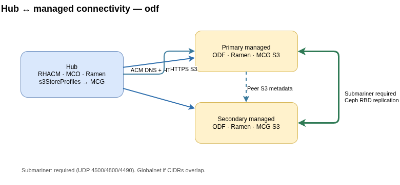
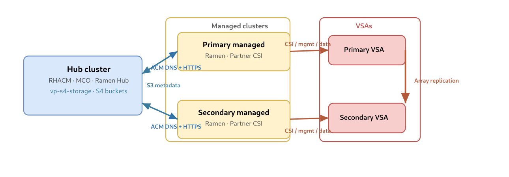

:toc:
:imagesdir: /images
:_content-type: ASSEMBLY
include::modules/comm-attributes.adoc[]

[id="ramendr-connectivity"]
= Hub-to-managed connectivity

Four install variants (`main.variant` in `values-global.yaml`):

* **odf** (default) — full {ocp-data-short} Regional DR; MCG S3 on managed clusters; Submariner required for Ceph RBD replication
* **techdemo** — same hub-to-managed connectivity as `odf`, plus Boutique, a Redis RHEL VM, a Windows desktop VM, and hub {ansible}
* **drpartner-s4** — partner CSI + hub S4; array-native volume replication; **Submariner disabled** (`submariner.enabled: false` in `opp-policy`)
* **minimal** — partner CSI operators and Hive/BYOC plumbing only; no S4, DRClusters, or Submariner

Draw.io source with one tab per variant: link:/images/ramendr-starter-kit/hub-managed-connectivity.drawio[`hub-managed-connectivity.drawio`].

[id="variant-comparison"]
== Variant comparison

[cols="2,1,1,1,1",options="header"]
|===
| Concern | odf | techdemo | drpartner-s4 | minimal

| S3 / DR metadata | MCG buckets on each managed cluster | Same as `odf` | Hub S4 buckets (`vp-s4-storage`) | None
| Hub S3 reachability | Hub → each managed MCG endpoint | Same as `odf` | Hub + managed → hub S4 | n/a
| Peer S3 | Managed ↔ managed object-bucket metadata | Same as `odf` | Not used | Not used
| Volume replication | {ocp-data-short}/Ceph over Submariner | Same as `odf` | VSA ↔ VSA (array-native) | External / out of pattern
| Submariner | Required for Regional-DR volumes | Required | **Disabled by default** | **Disabled**
| DRClusters / DRPolicy | MirrorPeer / MCO / regionaldr | Same as `odf` | regionaldr (`infrastructureEnabled`) | None
| DRPC / VMs / demo apps | Yes (regionaldr resources) | Yes + Boutique, Redis VM, Windows VM | No (`resourcesEnabled: false`) | No
| {rh-rhacm} + DNS | Required | Required | Required | Required
|===

[id="connectivity-odf"]
== `odf`

{rh-rhacm-first} needs DNS resolvability of managed cluster APIs. S3 metadata buckets (MCG) live **on each managed cluster** — hub and peers both reach those endpoints. **Submariner is required** for {ocp-data-short} RBD cross-site replication.

.ramendr-hub-managed-connectivity-odf

draw.io source: link:/images/ramendr-starter-kit/hub-managed-connectivity.drawio[`hub-managed-connectivity.drawio`] (**odf** tab).

[id="managed-mcg-s3-detail"]
=== Managed MCG S3 detail

++++
<pre class="mermaid">
flowchart LR
  Hub["Ramen Hub Operator"] --> MCG1["Primary MCG S3"]
  Hub --> MCG2["Secondary MCG S3"]
  MCG1 ---|"Peer metadata"| MCG2
</pre>
++++

[id="connectivity-techdemo"]
== `techdemo`

Hub-to-managed connectivity matches `odf`: DNS-resolvable managed APIs, MCG S3 on each managed cluster, and **Submariner required** for {ocp-data-short} RBD replication. Demo additions do not change the Regional DR network paths:

* Boutique on spokes uses Redis at `rhel9-redis-001.gitops-vms.svc` (in-cluster service to the Redis VM)
* Windows desktop VM uses RDP/SSH ports published by the VM service
* Hub {ansible} talks to managed clusters over the same API paths as {rh-rhacm}

.ramendr-hub-managed-connectivity-techdemo
image::/images/ramendr-starter-kit/hub-managed-connectivity-techdemo.png[techdemo hub-to-managed connectivity,title="techdemo connectivity"]

PNG from draw.io: link:/images/ramendr-starter-kit/hub-managed-connectivity-techdemo.png[`hub-managed-connectivity-techdemo.png`]. SVG source: link:/images/ramendr-starter-kit/techdemo-connectivity.svg[`techdemo-connectivity.svg`]. draw.io source: link:/images/ramendr-starter-kit/hub-managed-connectivity.drawio[`hub-managed-connectivity.drawio`] (**techdemo** tab).

[id="connectivity-drpartner-s4"]
== `drpartner-s4`

{rh-rhacm-first} needs DNS resolvability of managed cluster APIs. S3 metadata lives on **hub S4** (`vp-s4-storage`). Volume DR is array-native (VSA ↔ VSA). The `regional-dr` application creates hub DRClusters and a `2m-novm` DRPolicy only — no DRPC or VMs. **Submariner is not deployed** (`values-opp-policy.yaml` sets `submariner.enabled: false`).

.ramendr-drpartner-s4-connectivity

PNG from draw.io: link:/images/ramendr-starter-kit/hub-managed-connectivity-drpartner-s4.png[`hub-managed-connectivity-drpartner-s4.png`]. SVG source: link:/images/ramendr-starter-kit/drpartner-s4-connectivity.svg[`drpartner-s4-connectivity.svg`]. draw.io source: link:/images/ramendr-starter-kit/hub-managed-connectivity.drawio[`hub-managed-connectivity.drawio`] (**drpartner-s4** tab).

[id="hub-s4-detail"]
=== Hub S4 detail

++++
<pre class="mermaid">
flowchart LR
  Ramen["Ramen Hub Operator"] --> S4["Hub S4 buckets"]
  P["Primary DR operator"] --> S4
  S["Secondary DR operator"] --> S4
</pre>
++++

No managed ↔ managed S3 and no Submariner in `drpartner-s4`.

[id="connectivity-minimal"]
== `minimal`

{rh-rhacm-first} needs DNS resolvability of managed cluster APIs. The pattern deploys partner operators (MCO/Ramen, {VirtProductName}, OADP) and Hive/BYOC plumbing only — **no `vp-s4-storage`**, no DRClusters, no `s3StoreProfiles`, and **no Submariner**. Volume DR and S3 metadata are outside this pattern.

.ramendr-minimal-connectivity
image::/images/ramendr-starter-kit/minimal-connectivity.png[minimal hub-to-managed connectivity,title="minimal connectivity"]

PNG from draw.io: link:/images/ramendr-starter-kit/hub-managed-connectivity-minimal.png[`hub-managed-connectivity-minimal.png`]. SVG source: link:/images/ramendr-starter-kit/minimal-connectivity.svg[`minimal-connectivity.svg`]. draw.io source: link:/images/ramendr-starter-kit/hub-managed-connectivity.drawio[`hub-managed-connectivity.drawio`] (**minimal** tab).

[id="shared-requirements"]
== Shared requirements

* **{rh-rhacm} + DNS** — Hub must resolve each managed cluster API hostname, then connect over HTTPS 443 / kube API 6443.
* **TLS / CA trust** — Trust custom certs for S4 (`drpartner-s4`) or MCG endpoints (`odf`, `techdemo`) via `opp-policy` `s3CaInjector` where S3 is used.
* **Globalnet** — For `odf` and `techdemo`, enable if managed cluster/service CIDRs overlap.

[id="ports"]
== Ports

[cols="2,2,2",options="header"]
|===
| Path | When | Protocol / ports

| Hub DNS → managed API | All variants | DNS UDP/TCP 53
| Hub ↔ managed API | All variants | HTTPS 443; kube API 6443
| Clients → hub S4 | `drpartner-s4` | HTTPS 443
| Hub / peers → managed MCG | `odf`, `techdemo` | HTTPS 443
| Boutique → Redis VM | `techdemo` | TCP 6379 (in-cluster service)
| Clients → Windows VM | `techdemo` | TCP 22 (SSH); TCP 389 (RDP as published)
| Cluster ↔ local VSA | `drpartner-s4`, `minimal` | Vendor CSI / iSCSI / NVMe / mgmt
| VSA ↔ VSA replication | `drpartner-s4`, `minimal` | Vendor replication ports
| Submariner | `odf`, `techdemo` | UDP 4500 / 4800 / 4490
|===

[id="related-diagrams"]
== Related diagrams

[cols="2,2,2",options="header"]
|===
| Artifact | PNG | draw.io / other

| Full component schematic (`odf`)
| link:/images/ramendr-starter-kit/ramendr-architecture-odf.png[`ramendr-architecture-odf.png`]
| link:/images/ramendr-starter-kit/ramendr-architecture-odf.drawio[`ramendr-architecture-odf.drawio`]

| Full component schematic (`techdemo`)
| link:/images/ramendr-starter-kit/ramendr-architecture-techdemo.png[`ramendr-architecture-techdemo.png`]
| link:/images/ramendr-starter-kit/ramendr-architecture-techdemo.drawio[`ramendr-architecture-techdemo.drawio`]

| Full component schematic (`drpartner-s4`)
| link:/images/ramendr-starter-kit/ramendr-architecture-drpartner-s4.png[`ramendr-architecture-drpartner-s4.png`]
| link:/images/ramendr-starter-kit/ramendr-architecture-drpartner-s4.drawio[`ramendr-architecture-drpartner-s4.drawio`]

| Full component schematic (`minimal`)
| link:/images/ramendr-starter-kit/ramendr-architecture-minimal.png[`ramendr-architecture-minimal.png`]
| link:/images/ramendr-starter-kit/ramendr-architecture-minimal.drawio[`ramendr-architecture-minimal.drawio`]

| Connectivity overview (`odf`)
| link:/images/ramendr-starter-kit/hub-managed-connectivity-odf.png[`hub-managed-connectivity-odf.png`]
| link:/images/ramendr-starter-kit/hub-managed-connectivity.drawio[`hub-managed-connectivity.drawio`]

| Connectivity overview (`techdemo`)
| link:/images/ramendr-starter-kit/hub-managed-connectivity-techdemo.png[`hub-managed-connectivity-techdemo.png`]
| link:/images/ramendr-starter-kit/techdemo-connectivity.svg[`techdemo-connectivity.svg`]

| Connectivity overview (`drpartner-s4`)
| link:/images/ramendr-starter-kit/hub-managed-connectivity-drpartner-s4.png[`hub-managed-connectivity-drpartner-s4.png`]
| link:/images/ramendr-starter-kit/drpartner-s4-connectivity.svg[`drpartner-s4-connectivity.svg`]

| Connectivity overview (`minimal`)
| link:/images/ramendr-starter-kit/hub-managed-connectivity-minimal.png[`hub-managed-connectivity-minimal.png`]
| link:/images/ramendr-starter-kit/minimal-connectivity.svg[`minimal-connectivity.svg`]
|===

See also link:/patterns/ramendr-starter-kit/architecture/[Architecture] for TLS/CA handling and full schematic context.
